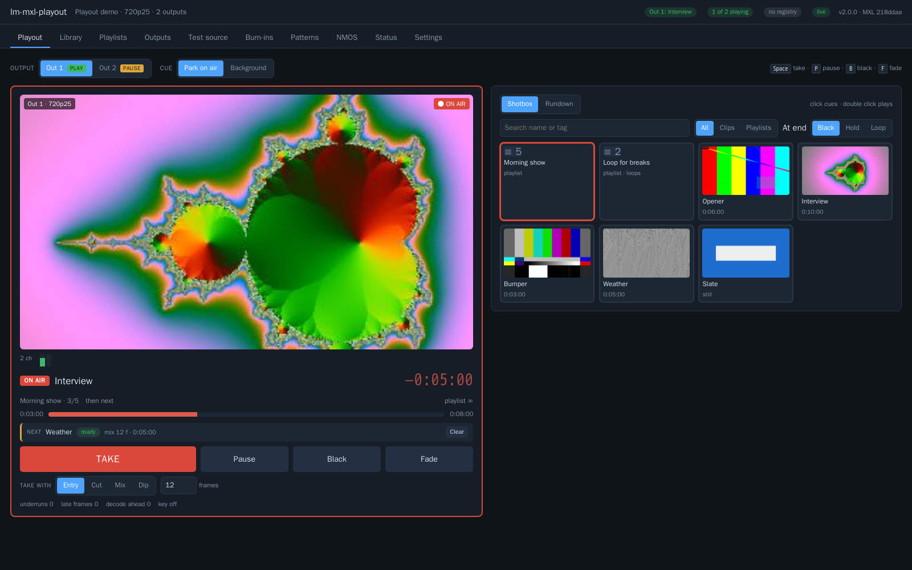

# lm-mxl-playout

MXL media playout. Operators upload clips, organise them into playlists and play out a single clip or a whole playlist, with cue and take, frame-accurate cuts, mixes and dips, countdowns and operator-screen widgets. Each output writes a `video/v210` flow and an `audio/float32` flow (optional `video/smpte291` timecode and a fill/key pair) and publishes them as an NMOS sender group.

A Livemotion fork of [mxl-test-player](https://github.com/LeeO86/mxl-test-player) (part of [mxl-stack](https://github.com/LeeO86/mxl-stack)). The test player's sources (patterns, test audio, burn-ins) are still there for line-up, under **Test source**; an output plays them when its source is set to one. Upstream fixes merge from the `upstream` remote.



```bash
cmake -S . -B build -G Ninja -DCMAKE_BUILD_TYPE=Release
cmake --build build -j
cd web && npm install && npm run build && cd ..
./build/lm-mxl-playout
```

Open `http://localhost:8130`.

Container images are `ghcr.io/livemotionch/lm-mxl-playout`. Pushes to `main` publish `nightly-dev` and `git-<sha7>`. A tag `vX.Y.Z` publishes `X.Y.Z`, `X.Y` and `X`. `nightly-dev` is the only tag that moves. The workflow is `.github/workflows/container.yaml` and the image is `docker/Dockerfile` (uid 1000).

```bash
docker build -f docker/Dockerfile -t lm-mxl-playout .
```

## Playout

Every output starts as a **playout** output: black and silence until an operator takes a clip. Burn-ins are off unless switched on.

- **Library.** Upload clips (any video or audio file FFmpeg reads, stills, GIF and APNG with alpha), tag them, search by name or tag. An upload plays as it is, ready in about a second: a video is decoded while it plays and conformed to the output format (size and aspect, frame rate, interlace, BT.601 to BT.709) by the filters a conversion would use, and a still or an animation is decoded when it is loaded. A file of audio only plays black with its audio. **Convert on upload** (or **Playback → Converted** on an item) makes a ProRes mezzanine per format instead, for files too heavy to decode live; motion-interpolated frame rates, a loop crossfade and a channel mapping need it, and choosing one converts.
- **Clip level.** The loudness of every upload with audio is measured (EBU R128: integrated, true peak, range). Each clip has a gain the outputs apply while it plays, so a level needs no conversion and a change is heard at once, also on air. **Level to −23 LUFS** (on by default at the upload, or **Level → Automatic** on an item) sets the gain from the measurement to `PLAYER_LOUDNESS_TARGET`, lowered when the true peak would go over −1 dBTP; a gain set by hand (−40 to +20 dB) ends it.
- **Playlists.** Ordered entries, each a library clip with an in and out point, what it does at its end (`next`: the next entry follows, `hold`: its last frame stays, `loop`: it loops until the next take, `stop`: black), the transition into it (`cut`, `mix`, `dip` through black, with a length in frames) and, for a still, its hold time (0: until the next take). A playlist can loop.
- **Cue and take.** Cue a clip or a playlist (from any entry) on an output. With nothing on air it is **parked** on air at its first frame (cue mode `park`, a clip player for a vision mixer) or waits in the background (`background`, a channel straight to air); with something on air it becomes the **next** clip. **Take** rolls a parked clip, or transitions to the next one with its own transition (or the operator's override). The next entry of a playlist is cued by itself, and loaded ahead: from RAM, or primed in a second decode-ahead stream, so a cut lands on the frame and a mix starts that many frames before the outgoing clip ends.
- **On air.** Pause and resume, seek, cut to black or fade to black. Countdowns to the end of the clip and of the playlist, the position, what is next and whether it is loaded.

The UI's **Playout** tab is the operator screen: the output's picture, meters and on-air panel (Take `Space`, Pause `P`, Black `B`, Fade `F`), with the shotbox (every clip and playlist: click cues, double click plays) or the rundown (the playlist on air, entry by entry). **Playlists** edits the rundowns; **Library** uploads and organises. The widgets put the same on operator screens.

Playout state (what is on air) is not kept over a restart: an output comes back black, with its playlists and cue mode.

## Run on the platform

The platform mounts `/Volumes/mxl`, sets uid 1000, and injects the pod IP as `NMOS_HOST_ADDRESS`. Use the pod network. Set `NMOS_SEED`, `NMOS_LABEL`, `NMOS_TAGS`, the registry and the Query API (registration port + 1), `MXL_OUTPUT_DOMAIN_DIR`, `MXL_CLEANUP_ON_EXIT=true` and a writable `/config`. `deploy/k8s/deployment.yaml` is an example. `production-up` waits for `/readyz`, which stays 503 until the Query API lists this node.

## Settings

Precedence is environment, then the JSON file (`--config`, else `PLAYER_CONFIG`, else `$CONFIG_DIR/player.json`), then the defaults. Unknown variables are ignored. Invalid values exit 78. A port that cannot be bound exits 75. SIGTERM exits 143. A clean stop exits 0.

| Setting | Default | Meaning |
| --- | --- | --- |
| `CONFIG_DIR` | `/config` | Only directory the process writes for its own state |
| `PLAYER_CONFIG` | `$CONFIG_DIR/player.json` | Config file path. Alias of `--config` |
| `PLAYER_STATE` | `$CONFIG_DIR/state.json` | Alias of the state file path |
| `PLAYER_FORMAT` | `1080p50` | Platform format (`1080i25` and `1080i29.97` are top field first; `1080i25bff` and `1080i29.97bff` bottom field first) |
| `PLAYER_OUTPUTS` | `2` | Output count, 1..16 |
| `PLAYER_AUDIO_CHANNELS` | `16` | Default audio channels |
| `PLAYER_LIBRARY_DIR` | `/data/library` | Mezzanine library; one player per directory (Kubernetes: `strategy: Recreate`). Items missing from its `index.json` are restored from their `item.json` at start |
| `PLAYER_IMPORT_DIR` | empty | Watched import directory |
| `PLAYER_CONVERT_CONCURRENCY` | `1` | ffmpeg jobs at once |
| `PLAYER_LOUDNESS_TARGET` | `-23` | LUFS the automatic clip level brings a clip to (EBU R128; −24 for ATSC A/85) |
| `PLAYER_DECODE_THREADS` | `4` | Decoder and filter threads of each clip that plays as uploaded. 1080p50 H.264 and 2160p25 HEVC 10-bit took 1.3 cores together on the build VM |
| `PLAYER_CONVERT_THREADS` | `2` | CPU threads per conversion. Conversions run at a lower priority (nice 10) than playout; keep threads plus one core per streaming output within the CPU limit |
| `PLAYER_RAM_CLIP_MAX_S` | `20` | Longest clip kept in RAM |
| `PLAYER_RAM_BUDGET_MB` | `4096` | One RAM budget for the whole process: every output's clips in RAM (videos up to `PLAYER_RAM_CLIP_MAX_S`, GIF and APNG clips; shared between outputs that play the same clip). Also bounds an animation's conversion |
| `PLAYER_PREROLL_FRAMES` | `25` | Frames decoded ahead when a video streams from its mezzanine (longer than `PLAYER_RAM_CLIP_MAX_S` or over the RAM budget) |
| `PLAYER_CUE_MODE` | `park` | A clip cued while nothing is on air: `park` (on air at its first frame, paused) or `background` (air stays black until the take). Per output `cue_mode` in the configuration file, or `PATCH /api/v1/outputs/{id}` |
| `PLAYER_AUTO_TAKE` | `false` | Auto take: when the clip on air is done (its end, also one that holds or stops; or already held or black) the cued clip goes on air by itself with its own transition, a mix starting before the end. A looping clip loops until a take. With nothing on air a cue goes on air once it is loaded instead of parking. Per output `auto_take` in the configuration file, `PATCH /api/v1/outputs/{id}` or the Playout tab |
| `PLAYER_FONT_DIR` | bundled | Font directory |
| `PLAYER_WEB_ROOT` | bundled | Built web UI |
| `PLAYER_UPLOAD_LIMIT_GB` | `20` | Upload limit |
| `PLAYER_SPRITE_MAX_PX` | `512` | Moving-box sprite size (an animation's sprite frames) |
| `MXL_DOMAIN_SCAN_PATH` | `/Volumes/mxl` | Parent of domain directories. No inputs are scanned |
| `MXL_OUTPUT_DOMAIN_DIR` | `<scan>/player-<seed>` | This function's domain. Created if missing |
| `MXL_OUTPUT_DOMAIN_ID` | UUIDv5(seed, `domain`) | Used when the domain is created; a different existing id is logged and kept |
| `MXL_HISTORY_DURATION_NS` | `1000000000` | Written into `options.json` only when that file is created |
| `MXL_CLEANUP_ON_EXIT` | `false` | Remove only this domain on shutdown |
| `NMOS_REGISTRY_ADDRESS` | empty | Registration API host. Empty disables registration |
| `NMOS_REGISTRY_PORT` | `3210` | Registration API port |
| `NMOS_QUERY_ADDRESS` | registry address | Query API host |
| `NMOS_QUERY_PORT` | registry port + 1 | Query API port |
| `NMOS_DNS_SD` | `false` | `true` exits 78. No Avahi and no mDNS |
| `NMOS_PORT` | `3282` | IS-04 node API and IS-05 connection API |
| `NMOS_SEED` | `$HOST_ID-player`; without `HOST_ID` a random `player-…` kept in `CONFIG_DIR/nmos_seed` (the hostname when that is not writable), with a warning | UUIDv5 root for every id. Set it: two players with the same seed share node and device ids and remove each other's resources. Sender, source and flow ids also depend on the output's position (Out 1, Out 2, …), so reordering outputs changes them |
| `NMOS_LABEL` | `MXL Playout` | Node label and device label |
| `NMOS_TAGS` | `{}` | JSON object of tag name to string array |
| `NMOS_HOST_ADDRESS` | first non-loopback IPv4 | Address announced to NMOS. Not a name, `0.0.0.0` or loopback |
| `HOST_ID` | unset | Legacy seed prefix when `NMOS_SEED` is unset. Not an address |
| `SHUTDOWN_TIMEOUT_S` | `10` | Bound for SIGTERM cleanup |
| `WEB_PORT` | `8130` | UI, REST, probes, metrics, `/api/v1/events`, and the widgets |
| `WIDGET_FRAME_ANCESTORS` | `'self'` | CSP `frame-ancestors` of the `/widget` pages; `/widgets` answers these origins with CORS. `;`, `,` or control characters exit 78 |

`NMOS_HOST_ADDRESS` is the node `href`, `api.endpoints[].host` and the IS-05 control href. `HOST_ID` is not announced. The UI WebSocket is on `WEB_PORT`. This process does not listen on `NMOS_PORT+1`.

## Exit codes

| Code | When |
| --- | --- |
| 0 | Clean stop (SIGINT) |
| 75 | The web or NMOS port could not be bound, or the MXL domain could not be opened |
| 78 | Invalid configuration, including a bad address, `NMOS_DNS_SD=true`, or a `domain_def.json` without an id |
| 143 | SIGTERM after cleanup, or cleanup that exceeded `SHUTDOWN_TIMEOUT_S` |

## API

| Method | Path |
| --- | --- |
| GET | `/livez`, `/readyz`, `/statusz`, `/metrics` |
| GET | `/api/v1/info`, `/api/v1/config`, `/api/v1/config/export`, `/api/v1/nmos` |
| POST | `/api/v1/config/import` |
| GET, PATCH | `/api/v1/outputs`, `/api/v1/outputs/{id}` (also `master_video`, `master_audio`, `master_data`, `master_key`) |
| POST | `/api/v1/outputs/{id}/playout` (below) |
| POST | `/api/v1/outputs/{id}/transport` (`play`, `pause`, `stop`, `restart`, `step`), `/api/v1/outputs/{id}/seek` |
| PUT | `/api/v1/outputs/{id}/source`, `/api/v1/outputs/{id}/burnin` |
| GET | `/api/v1/outputs/{id}/thumbnail`, `/api/v1/outputs/{id}/probe[?index=]`, `/api/v1/outputs/{id}/meters` (peak per channel of the last grain), `/api/v1/library/{id}/thumbnail` |
| GET, POST, DELETE | `/api/v1/library`, `/api/v1/presets`, `/api/v1/playlists` (`/api/v1/playlists/{id}` for GET and DELETE) |
| PATCH, POST | `/api/v1/library/{id}` (name, tags; the level: `gain_db`, `loudness: true` for the automatic level, `measure: true` to measure again), `/api/v1/library/{id}/reconvert` (`{"direct": true}` plays the original again and deletes the conversions; else it converts) |
| PUT, PATCH | `/api/v1/playlists/{id}` (PUT replaces it, PATCH changes the fields it names) |
| POST, PUT | `/api/v1/uploads`, `/api/v1/uploads/{id}/chunks/{n}`, `/api/v1/uploads/{id}/complete` |
| GET | `/api/v1/jobs` |
| WebSocket | `/api/v1/events` on `WEB_PORT` |
| GET | `/widgets`, `/widget/transport?output=<n>`, `/widget/shotbox?output=<n>`, `/widget/rundown?output=<n>[&playlist=<id>]`, each `[&theme=dark\|light\|transparent]` (below) |
| GET, PATCH | `/x-nmos/node/v1.3/…`, `/x-nmos/connection/v1.1/single/senders/{id}/staged` on `NMOS_PORT` |

`POST /api/v1/outputs/{id}/playout` takes `{"action": …}`, effective at the next frame the output writes, and answers the output's status (its `playout` object: `state` idle, parked, playing, paused, ended, waiting, transition or fading; `program`, `incoming`, `next` with name, entry, position, frames, `remaining_s` and `ready`; `transition`; `playlist` with `remaining_s`; `cue_mode`; `auto_take`):

| Action | Body |
| --- | --- |
| `cue` | `item_id` with optional `in_s`/`out_s` (or `in`/`out` in frames), `end` (default `stop`), `hold_s` for a still (0: until the next take), `transition`, `transition_frames`; or `playlist_id` with `entry` (index) or `entry_id`. `take: true` takes it at once |
| `take` | optional `transition` (`cut`, `mix`, `dip`) and `transition_frames` override the cued entry's. 409 when nothing is cued, parked or paused |
| `pause`, `resume` | the clip on air |
| `stop` | black; with `transition` `mix` and `transition_frames` a fade. The next clip stays cued |
| `clear` | removes the next clip |
| `seek` | `frame` (from the clip's in point) or `seconds` |
| `jump` | cues `entry` or `entry_id` of the playlist on air (or of `playlist_id`) as the next clip |

A playlist is `{id, name, loop, entries: [{id, item_id, in_s, out_s, hold_s, end, transition, transition_frames}]}`; the player gives entries their ids. A playlist plays as it was cued: edit it and cue it again to change what is on air. On a playout output the test player's transport still works (`play` takes or resumes, `pause`, `stop` cuts to black, `restart`, `step`).

The test player's sources: fire a clip with `PUT /api/v1/outputs/{id}/source` (`{"type": "video", "item_id": "<id>"}`, or `still`, `pattern`, `playlist`) and `POST /api/v1/outputs/{id}/transport` (`{"action": "restart"}`). An animated GIF or APNG (`sprite` item) plays the same way, as a loop with its alpha (`v210a` or `fill_key`); in a playlist set through the API its entry needs `frames` = the item's `clip_frames` for the output's format. It is converted per format into raw frames: about 8 MB of library disk per GIF frame and format at 1080 lines (33 MB at 2160). The `transparent` pattern is black at alpha 0, for a keyed output of burn-ins only. An output that feeds a keyer with graphics should set `idle_key: transparent` (patterns, videos and stop carry the idle key; an item with alpha that is not ready is transparent).

`GET /api/v1/config/export` is one JSON document (`version`, informational `deployment`, and `state`). There are no secrets to omit. `POST /api/v1/config/import` restores outputs, presets and playlists. It does not change ports, the registry or the seed. `GET /api/v1/config` remains the live view.

`GET /api/v1/config` also lists every setting with its effective value and origin (`environment`, `file`, `argument` for `--config`, `default`). `GET /api/v1/info` has the version and the MXL revision.

The web UI (tabs Playout, Library, Playlists, Outputs, Test source, Burn-ins, Patterns, NMOS, Status, Settings) uses only this API. `PUT /api/v1/outputs/{id}/source` with `{"type": "playout"}` brings an output back from a test source.

Widgets: operator screens can frame them, each for one output (1 is Out 1). `GET /widgets` lists them as `[{id, title, params, min_size, version}]` (`params` is a JSON schema of the query). `transport` (`min_size` 420×220) is the on-air panel: state, clip, countdown, position, next, Take / Pause / Black / Fade (an output on a test source shows its Play/Pause/Stop transport instead). `shotbox` (400×300) is every clip and playlist: a click cues it, a double click plays it. `rundown` (420×320) is the playlist on air (or `playlist`), with Next and Play per entry. The page uses the player's own API and posts `widget-ready` and `widget-size` to its parent. Only the pages that `WIDGET_FRAME_ANCESTORS` names may frame it; on the platform set it to `'self' https://designer.<fqdn>`. `cd web && PLAYER_API=http://<player>:8130 npm run dev` runs it against a running player.

`/readyz` is 200 when the process is serving and, if a registry is configured, `GET /x-nmos/query/v1.3/nodes/{id}` on the Query API returns 200.

## Tests

```bash
./build/player_tests
python3 tests/integration/playout.py          # PLAYOUT_STREAM=1: every clip streams from its mezzanine
python3 tests/integration/lifecycle.py
python3 tests/integration/play_loop.py
python3 tests/integration/keying.py [--shots DIR]
```

`playout.py` reads the written grains back and checks that a playlist's cut, a 10-frame mix and a dip land on the frame (no black, no repeated frame), from RAM and streamed. `keying.py` reads the MXL grains back with `build/player_grain_dump <domain> <flow id> <index|-N> <file>` (a lab tool built with the tests) and checks the alpha and key values.

See `IMPLEMENTATION_PLAN.md` for the G1–G14 audit and `deploy/` for Compose, Kubernetes and Grafana.
